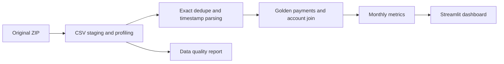

Batch pipeline is appropriate for the assignment. Production additions: source contracts, incremental watermarks, late-event backfills, lineage, orchestration, access controls and metric monitoring.
